# 🏙️ CitySim 3D

Градостроитель в браузере в духе Cities: Skylines. **Свободные дороги** (прямые и кривые, любые углы, перекрёстки, мосты),
зонирование клеток вдоль дорог, электричество и вода, службы, транспорт (машины, грузовики, автобусы), экономика,
пожары, смена дня и ночи, процедурный звук, русский и английский языки.

Стек: **Vite + TypeScript + Three.js**, минификация **terser** с манглом приватных свойств (`_name`), тяжёлые расчёты в **Web Workers**, тесты на **Vitest**.

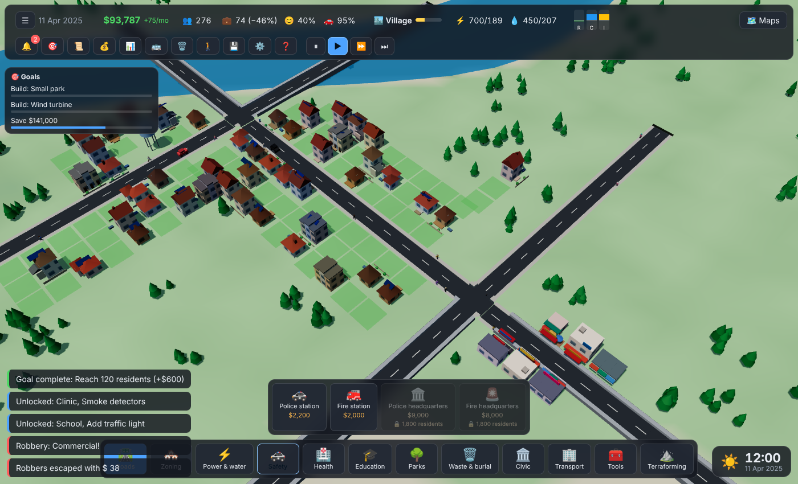

<p align="center">
  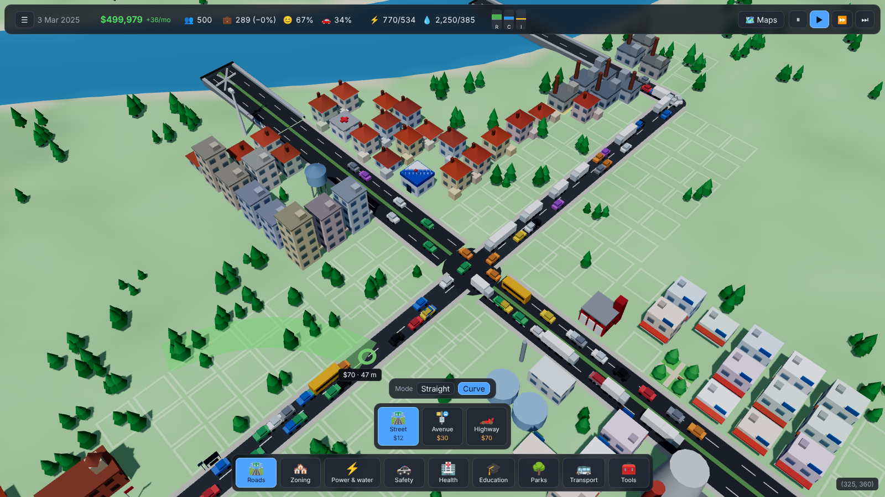
  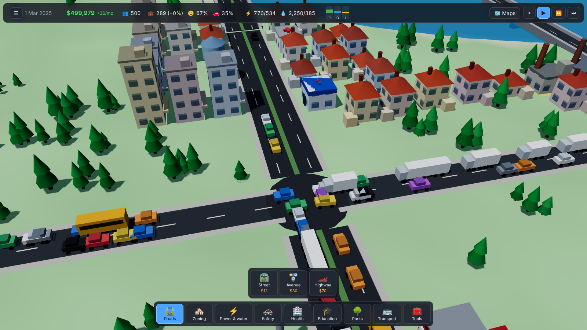
</p>
<p align="center">
  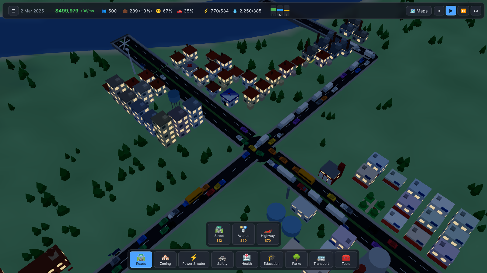
  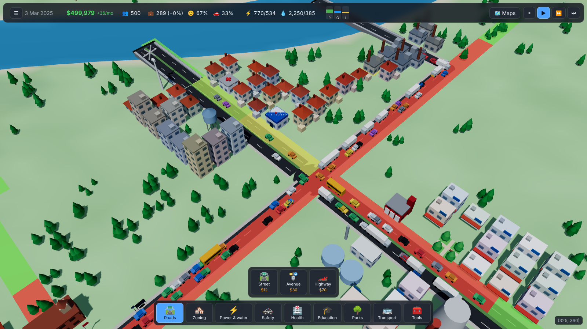
</p>
<p align="center">
  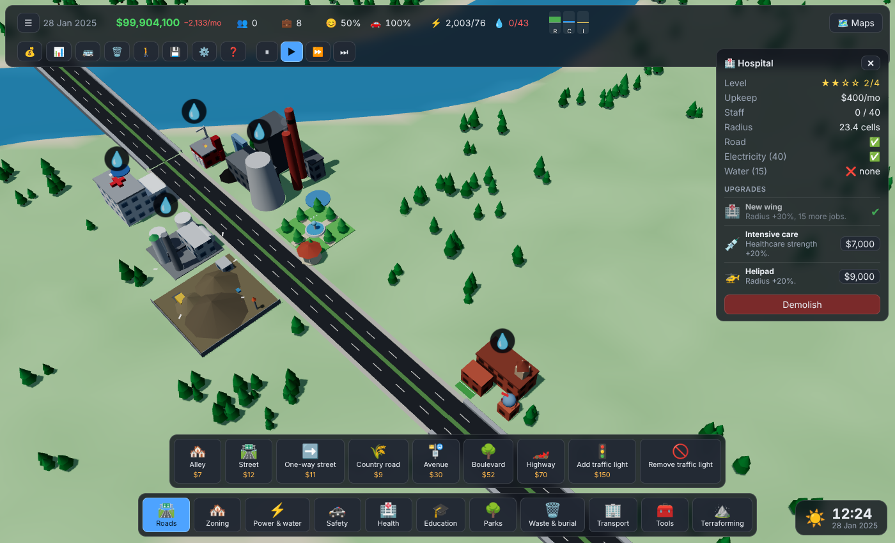
  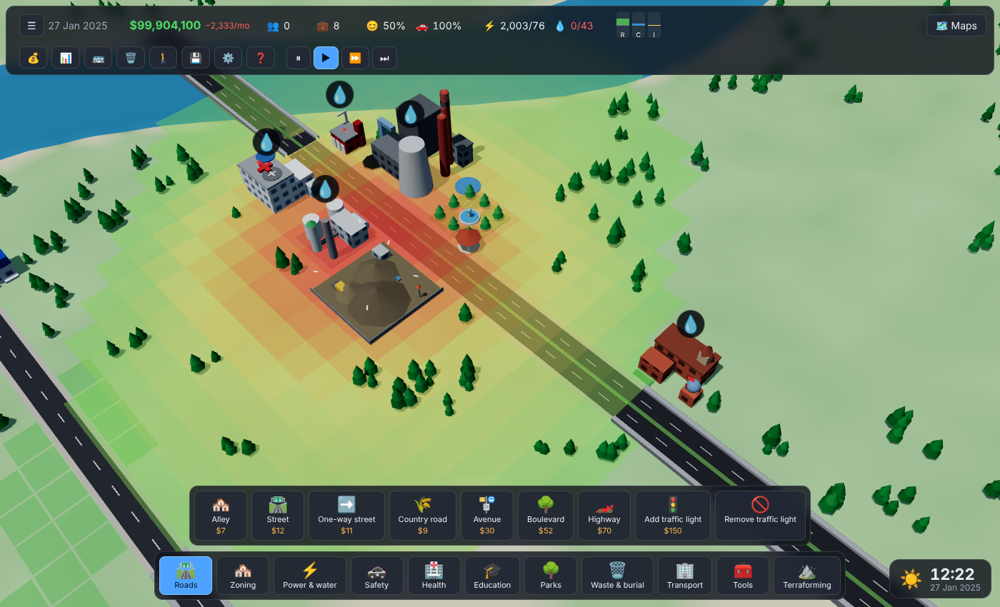
</p>
<p align="center">
  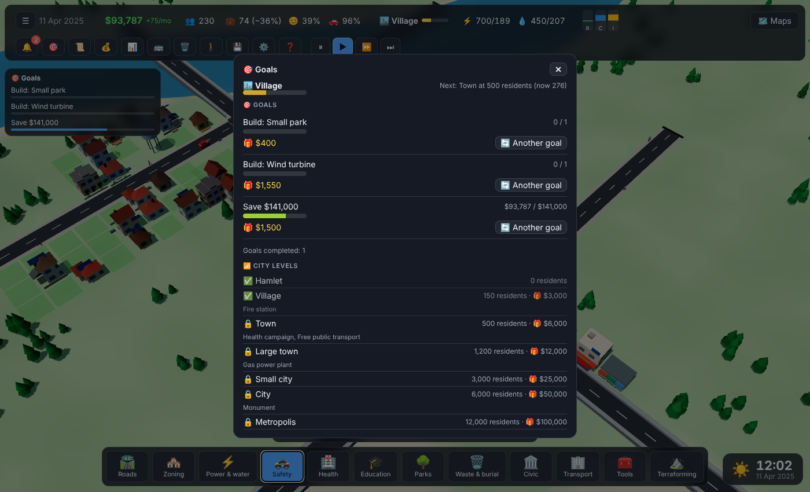
  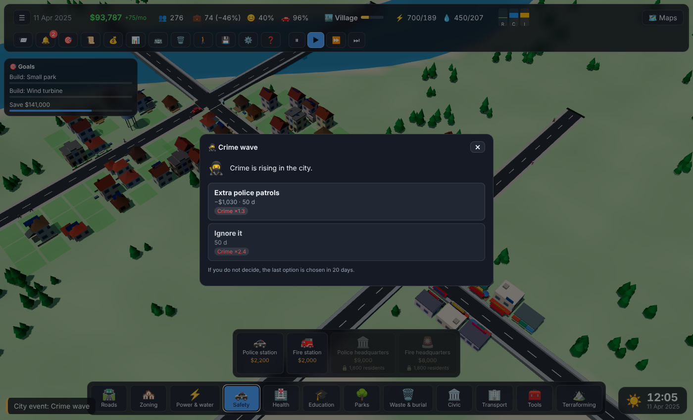
</p>
<p align="center">
  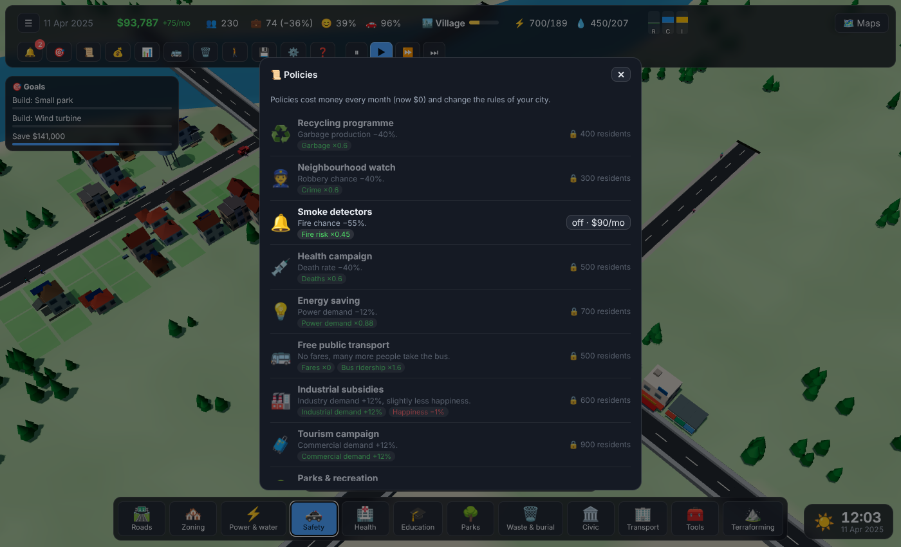
  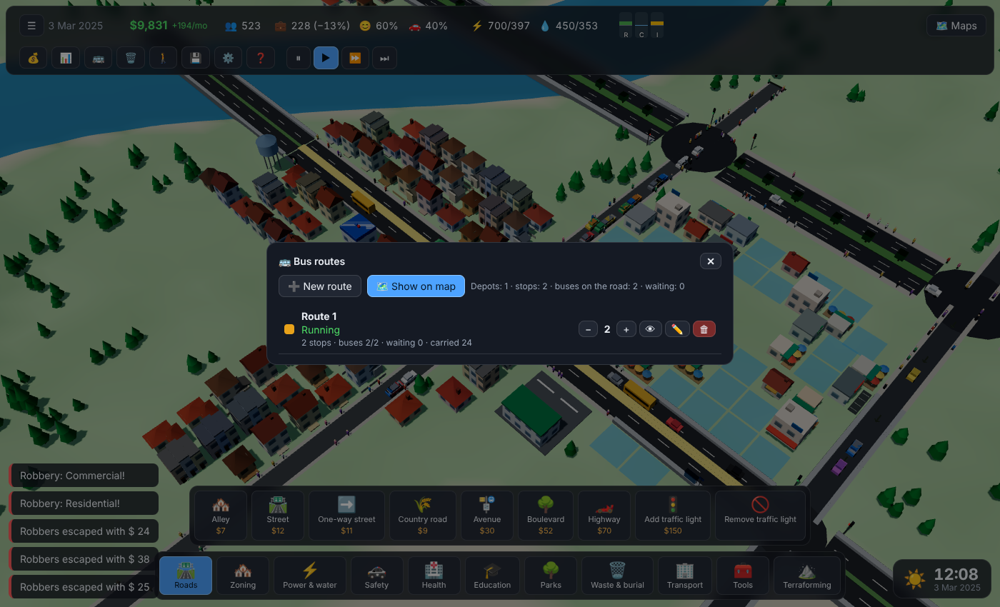
  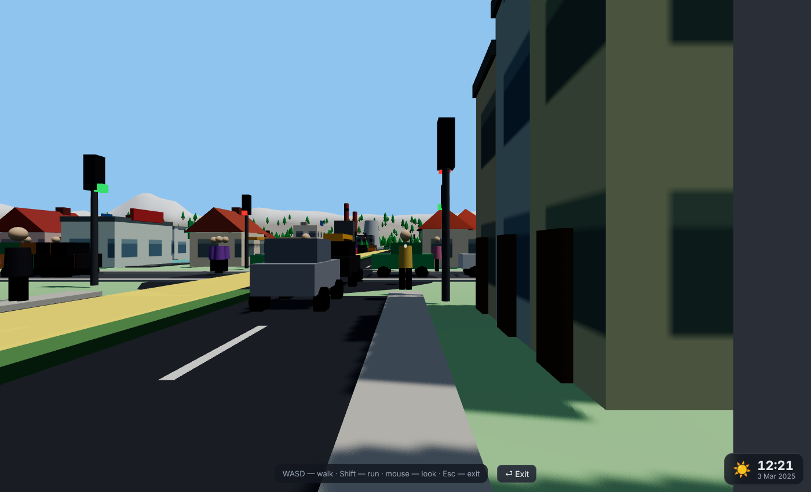
</p>

<p align="center">
  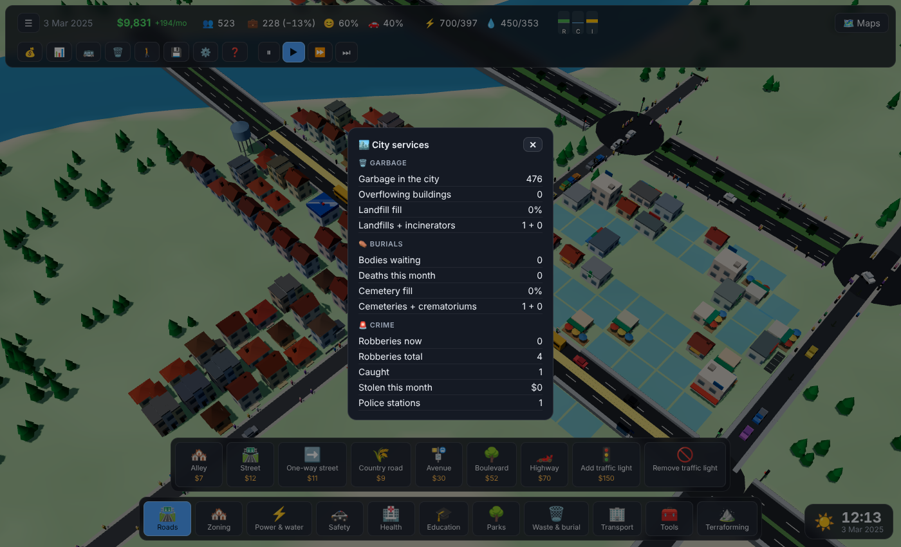
  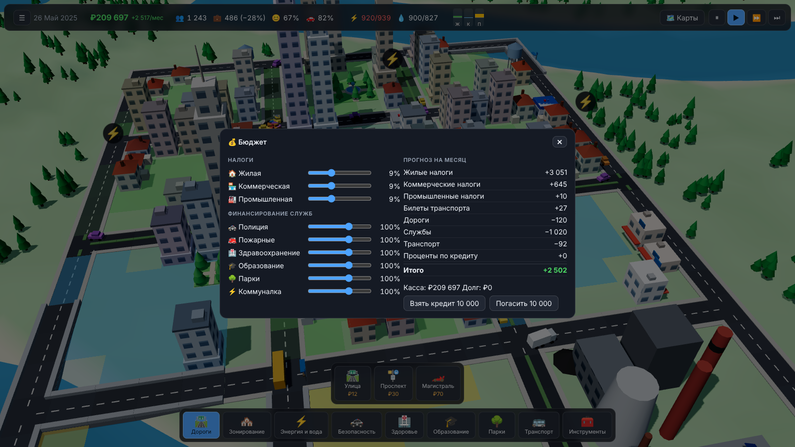
  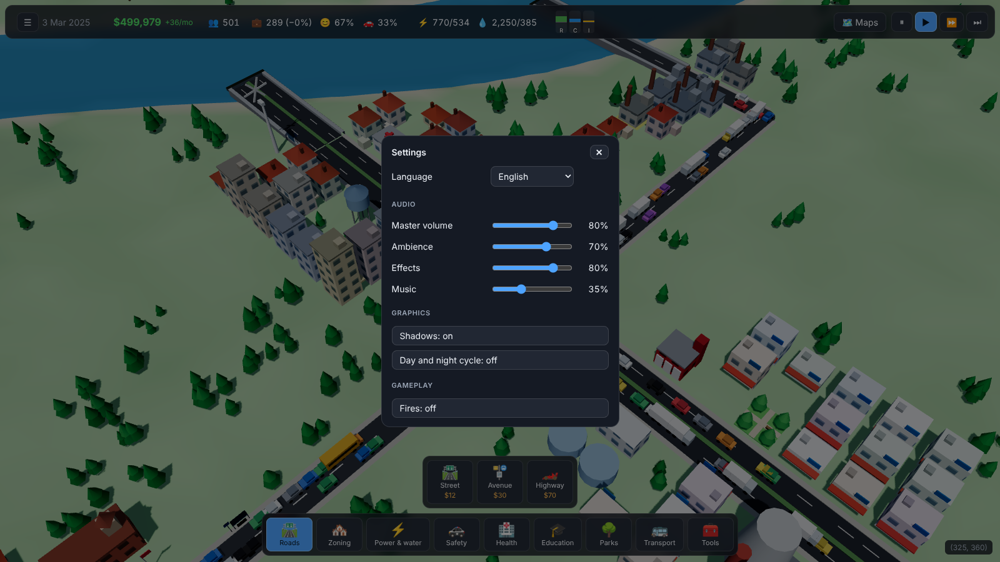
</p>

## Быстрый старт

Нужен **Node.js 20.19+ / 22+** и браузер с WebGL. На Arch Linux: `sudo pacman -S nodejs npm git`.

```bash
git clone https://github.com/bandiwor/citysim-3d.git
cd citysim-3d
npm install
npm run dev          # http://localhost:5173
```

| Команда | Что делает |
| --- | --- |
| `npm run dev` | сервер разработки (в консоли доступны `game`, `renderer`, `ui`, `audio`) |
| `npm test` | unit-тесты (Vitest) |
| `npm run typecheck` | проверка типов |
| `npm run build` | типы + тесты + продакшн-сборка в `dist/` (рядом `.gz` и `.br`) |
| `npm run preview` | предпросмотр сборки на http://localhost:4173 |

## Управление

* **ЛКМ** — инструмент; в режиме «Выбор» перетаскивание двигает камеру.
* **ПКМ** (зажать) — вращение камеры; клик ПКМ или **Esc** — отмена текущей операции / возврат к «Выбору».
* **СКМ**, **WASD**, стрелки — перемещение; **Q/E** — поворот; **R/F** — наклон; **колесо** — масштаб.
* **Пробел** — пауза, **1/2/3** — скорость, **X** — снос, **B** — бюджет, **G** — статистика.
* **Дороги:** клик — начало, клик — конец (или протяжка); дорога продолжается от конца. **C** — режим «кривая»
  (начало → опорная точка → конец), **Shift** — угловая привязка. Привязка к узлам и к середине дорог (с разрезанием).
* **Зоны:** кистью по клеткам (цвет кисти = цвет зоны, «Очистить зону» — красная кисть); **[** и **]** — размер кисти.
* **Рельеф:** кисти «поднять / опустить / выровнять / сгладить» (зажать ЛКМ); рядом с дорогами и зданиями земля защищена.
* **Светофоры:** инструменты «Поставить / Убрать светофор» кликом по перекрёстку (3+ дороги).
* **Общественный транспорт:** `T` — маршруты; **депо** → остановки → инструмент «Маршрут» (клики по остановкам по порядку,
  Backspace — убрать последнюю, Enter — готово). Путь считается автоматически при каждом изменении.
* **Городские службы:** `H` — мусор, кладбища, преступность. **P** — прогулка от первого лица (WASD, Shift, мышь, Esc — выход).
* Все окна открываются и кнопками в шапке (💰 📊 🚌 🗑️ 🚶 💾 ⚙️ ❓), часы с игровым временем — справа внизу.
* **Службы:** прижимаются к дороге фасадом к ней; **,** и **.** — поворот вне дороги.

### Телефон (альбомная ориентация)

Игра рассчитана и на сенсорный экран: **один палец** — инструмент (в режиме «Выбор» — перетаскивание карты), **два пальца** — сдвиг,
щипок-масштаб и поворот камеры. Здания, светофоры, остановки ставятся **вторым касанием** в то же место (первое показывает превью).
Справа — экранные кнопки: отмена, подтвердить, поворот, режим кривой, размер кисти, наклон камеры. В режиме от первого лица левая половина
экрана — стик ходьбы, правая — обзор. Интерфейс в альбомной ориентации сжимается, панели прокручиваются.

## Как это работает

* **Дороги — граф.** Узлы и рёбра-ломаные (кривые Безье дискретизируются). Пересечения создают узлы и делят рёбра,
  длинные участки режутся на сегменты ≤ 40 ед. Нельзя строить на холмах и сквозь здания; через воду — мосты (×3 цена).
* **Клетки зонирования** порождаются вдоль дорог (3 ряда с каждой стороны), ориентированы по дороге и смотрят на неё.
  Новая дорога убирает пустые клетки под собой, снос — достраивает недостающие; клетки без дороги исчезают.
* **Сеть = электричество и вода:** связная компонента графа снабжается станциями; при дефиците ресурс достаётся старым зданиям.
* **Рост:** по спросу R/C/I здания занимают размеченные клетки, растут до уровня 3 (стоимость земли, образование, счастье),
  без коммуналки или при несчастье — забрасываются и сносятся.
* **Транспорт:** поездки домой↔работа/магазины по A* с учётом пробок и светофоров; машины держат дистанцию (нет наездов друг на друга), на перекрёстке одновременно проезжает одна группа подхода (на светофоре — одна фаза, левый поворот не едет вместе с чужим потоком), повороты — плавные дуги; грузовики возят товары; односторонние
  дороги учитываются в поиске пути. Типы дорог: переулок, улица, односторонняя, просёлочная, проспект, бульвар, шоссе.
* **Общественный транспорт:** автобусы выезжают **только из депо**. Маршрут — упорядоченный список остановок (кольцо), путь
  между ними считает игра. На остановках копятся пассажиры: `жители рядом × спрос по времени суток × привлекательность
  пункта назначения` — утром едут на работу, днём в магазины, вечером домой (`transit.purposeMix`); очередь ограничена.
  Автобусы высаживают/сажают людей, получают плату за проезд; в панели маршрутов видно статус, очереди, перевезённых, можно следить за автобусом.
* **Мусор и погребение:** здания производят мусор, жители умирают; мусоровозы и катафалки выезжают из свалок, мусоросжигательных
  заводов (дают энергию), кладбищ и крематориев. Невывезенное снижает счастье.
* **Ограбления:** вероятность зависит от активности здания, безработицы и покрытия полицией; полиция выезжает на вызов.
* **Уровни и улучшения:** у зданий зон — уровень 1–3 (★ в инспекторе и подсказке; условия следующего уровня — стоимость земли и образование,
  карта «Уровень зданий»). У служб есть **улучшения** (панель выбранного здания): например, электростанции — скрубберы, турбины, улавливание
  углерода; они меняют характеристики (выработка, радиус, ёмкость, парк машин, загрязнение) и **внешний вид**. Данные — `ServiceDef.upgrades`.
* **Анимации и звуки зданий:** вращаются ветряки, дымят трубы, мигают мигалки полиции/пожарных, бьют фонтаны, над свалкой кружат чайки;
  рядом слышны ветряки, механизмы, фонтаны, чайки, дети (`ServiceDef.sound`).
* **Люди:** взрослые, дети и пожилые, разные цвета кожи/одежды, шапки, рюкзаки; шагают с качанием рук и ног.
* **Автовыравнивание:** при постройке дороги/здания на холме рельеф срезается автоматически (в цену добавляется стоимость, см. подсказку).
* **Интересная игра (карьера):**
  * **Уровни города** (Хутор → Мегаполис) по пиковому населению: за каждый — денежная награда, а дороги, службы и политики **открываются постепенно**
    (на кнопках замок с нужным числом жителей). Режим **«Песочница»** на стартовом экране — всё открыто сразу.
  * **Цели** (`J`): всегда активны три задания под ваш город — население, постройки, счастье, прибыль, занятость, транспорт, уровень зданий…
    За выполнение — деньги; цель можно заменить.
  * **Политики** (`K`): за ежемесячную плату меняют правила — переработка мусора, народная дружина, датчики дыма, бесплатный транспорт,
    субсидии промышленности, энергосбережение и др. (через `ModifierSystem`).
  * **События города**: раз в несколько месяцев приходит ситуация с выбором «деньги против последствий» — фестиваль, жара, грипп,
    волна преступности, грант, бум и рецессия (`data/events.ts`); не ответили — через время применится вариант по умолчанию.
  * **Советник** 🔔: список проблем (нет электричества, пробки, безработица, мусор…) с переходом к месту на карте.
  * **Экономика:** излишки энергии и воды продаются; **мэрия** повышает налоги; **монумент** — символ города с огромным радиусом счастья.
* **Стройка по стадиям:** новое здание сначала не работает — виден фундамент, затем растёт каркас, рядом стоит кран (высота мачты по размеру
  будущего здания). Повышение уровня и улучшение службы тоже идут со стройкой: здание работает, вокруг него леса и кран.
  Спрос гасится пустующими и строящимися зданиями, поэтому кварталы растут постепенно. Здания строятся и без электричества/воды —
  нехватка даёт дебафы (счастье, налоги, заброшенность через 90 с), а не блокирует рост.
* **Болезни:** вспышка начинается в одном доме, заражает его жителей, а при большом числе больных — соседние дома; лечат поликлиники и больницы
  (покрытие здравоохранения), потолок заболевших ограничивает эпидемию. Тяжёлые случаи → тела, катафалк. Тела без вывоза: значок через 40 с,
  недовольство соседей через ~2 мин. **Пожары** перекидываются на соседей (с потолком). Ограбления, пожары и болезни включаются только после
  открытия полиции, пожарной части и медицины.
* **Дороги:** привязка — умная / выкл / сетка / строго 90° (клавиша `V`, кнопка 🧲 на телефоне), `C` — кривая; здания из заливки зонами на пути
  дороги сносятся автоматически (оранжевая подсветка в превью).
* **Время суток:** часы показывают то же время, что и освещение (06:00 рассвет, 12:00 полдень, 18:00 закат); утренний и вечерний свет окрашены.
* **Первое лицо:** прохожие на тротуарах (число зависит от населения и времени суток), люди на остановках, столкновения со зданиями и водой.
* **Экономика:** налоги по зонам, содержание дорог/служб/транспорта, кредит, помесячный баланс.
* **Звук** (WebAudio, без файлов): слои эмбиента зависят от камеры и города — гул города, шум трафика и гудки при пробках,
  заводы, ветер, птицы днём и сверчки ночью, вода, сирена при пожаре; генеративная музыка; звуки действий.

## Архитектура

```
src/
  config/     gameConfig.ts — ВСЕ игровые константы (баланс, скорости, вероятности, звук…) + mergeConfig
  core/       Game (реестры, системы, шина событий), System/Feature, Tool, Registry, EventBus
  data/       данные: типы дорог, зон, служб (названия — в словарях i18n)
  i18n/       en.ts (источник ключей), ru.ts (обязан иметь те же ключи), t()/setLocale()
  world/      World, RoadGraph, ZoneGrid, zoning (генерация клеток), geometry, рельеф, шум
  sim/        системы: Network, Utility, Maps, Stats, Demand, Growth, Economy, Traffic, Fleet, Transit, Sanitation, Crime, Pedestrians, Disaster, Save + Builder
  workers/    вычислительный слой: pathfinder, maps, compute.worker, WorkerCompute / InlineCompute
  audio/      AudioEngine (WebAudio), mixer (чистая функция микса), collect
  render/     Three.js: Renderer, виды (Terrain/Road/Building/Vehicle/Tree/Zone/Preview/…), процедурные модели
  tools/      инструменты игрока (дорога, зоны, здание, снос, остановка, маршрут, светофор, рельеф, прогулка)
  ui/         HUD, панель инструментов, панели, настройки, ввод
  features/   «фичи» — пакеты (данные + системы + кнопки + оверлеи)
tests/        unit-тесты
```

### Web Workers

`ComputeBackend` (`src/workers/protocol.ts`) — интерфейс тяжёлых вычислений. В браузере это `WorkerCompute`:
**генерация рельефа**, **карты влияния** (покрытие служб, загрязнение, шум, стоимость земли) и **поиск пути A\*** по снимку графа
(с учётом загруженности рёбер) выполняются в `compute.worker.ts`. В тестах и без Worker — `InlineCompute` (тот же код синхронно).
Результаты пути приходят асинхронно и отбрасываются, если граф успел измениться.

### Игровые константы

Не хардкодьте числа в системах: добавьте поле в `src/config/gameConfig.ts` и читайте `game.config.<раздел>.<поле>`.
Переопределения передаются в `new Game({ config: { economy: { startMoney: 1000 } } })` (глубокое слияние, см. `mergeConfig`).

### Локализация

Все тексты — в `src/i18n/en.ts` и `ru.ts`. Данные находят свои названия по соглашению ключей:
`road.<id>.name|desc`, `zone.<id>.name|desc|short`, `service.<id>.name|desc`, `overlay.<id>.name`, `category.<id>.name`, `tool.<id>.name|desc`.
Сообщения игроку — `game.message('msg.key', { params })`. Добавить язык: новый словарь + запись в `LOCALES`.
Тест `tests/i18n.test.ts` проверяет, что ключи в словарях совпадают, плейсхолдеры согласованы, а все используемые в коде ключи существуют.

### Как добавить механику

Всё подключается через `Feature` (`game.use(...)`). Системы получают друг друга через типобезопасный `game.get('economy')`,
связываются событиями `game.bus` (`src/core/events.ts`).

```ts
// src/features/garbage.ts
declare module '../core/Game' { interface SystemMap { garbage: GarbageSystem } }

class GarbageSystem implements System {
  readonly id = 'garbage';
  readonly order = 45;
  private _game!: Game;
  init(game: Game) { this._game = game; game.bus.on('time:month', () => { /* ... */ }); }
  update(dt: number, realDt: number) { /* dt — игровое время (0 на паузе), realDt — реальное */ }
}

export const garbageFeature: Feature = {
  id: 'garbage',
  install(g) {
    g.addSystem(new GarbageSystem());
    g.overlays.add({ id: 'garbage', icon: '🗑️', paint: (game, painter) => { /* painter.set(cell, r, g, b, a) */ } });
    g.toolbar.add({ id: 'my-tool', category: 'tools', nameKey: 'tool.my.name', icon: '🗑️', createTool: (game) => new MyTool(game) });
  },
};
// main.ts: game.use(garbageFeature)  +  добавить ключи в en.ts/ru.ts
```

* **Новая служба:** запись в `src/data/services.ts` + модель `serviceModels.set('key', …)` в `render/models.ts` + переводы.
* **Новая зона** (например, офисы): запись в `data/zones.ts` + формула спроса `game.get('demand').formulas.set('office', () => …)`.
* **Новый тип дороги:** запись в `data/roads.ts`.
* **Новый слой влияния:** источник в `MapsSystem.collectSources` и вес в `config.maps.landValue.weights`.

## Сборка и сжатие JS

См. `vite.config.ts`:

* `build.minify: 'terser'`, 3 прохода compress, `toplevel`, `drop_console`.
* `mangle.properties.regex = /^_/` — **все свойства и методы, начинающиеся с `_`, укорачиваются.** Поэтому приватные члены
  классов пишутся как `private _name`. Публичные поля (`world.graph`, `building.pop` …) не трогаются — их безопасно
  сериализовать и передавать в воркер. Через `postMessage` ходят только обычные объекты без `_`-полей.
* Таргет `es2022`: поля классов остаются нативными. При более низком таргете их превращают в `defineProperty(this, "_x")`
  со строковыми именами, которые мангл не переименовывает, — код ломается.
* Опасные флаги `unsafe_*` не включены (`unsafe_arrows` ломает `new function(){}` внутри three.js).
* Основной бандл — один чанк (согласованные имена); воркер собирается отдельным бандлом с теми же настройками.
* Плагин `precompress` кладёт `*.gz` и `*.br` (для `gzip_static` / `brotli_static`).

## Тесты

`npm test` — около 100 unit-тестов (Vitest, окружение node, воркеры подменяются `InlineCompute`):

| Файл | Что проверяет |
| --- | --- |
| `geometry`, `roadGraph`, `zoning` | геометрия, граф (деление, поиск, компоненты), генерация и удаление клеток |
| `builder` | построение дорог (пересечения, привязка, ошибки, мосты, цена), зоны, службы, остановки, снос |
| `pathfinder`, `misc` | A*, карты влияния, рельеф, конфиг, шина событий, реестр, звуковой микшер |
| `systems` | время, сеть, коммуналка, экономика, спрос, статистика, рост, карты, трафик, транспорт, пожары, сохранение |
| `tools` | поведение инструментов (дорога, зоны, здание, снос, остановка) |
| `i18n` | паритет словарей и полнота ключей |

## Ограничения

Окружение — процедурный low-poly; жители агрегированы по зданиям (машины — визуализация потоков с реальным поиском пути и
влиянием пробок); здания на клетках зонирования имеют размер одной клетки.
