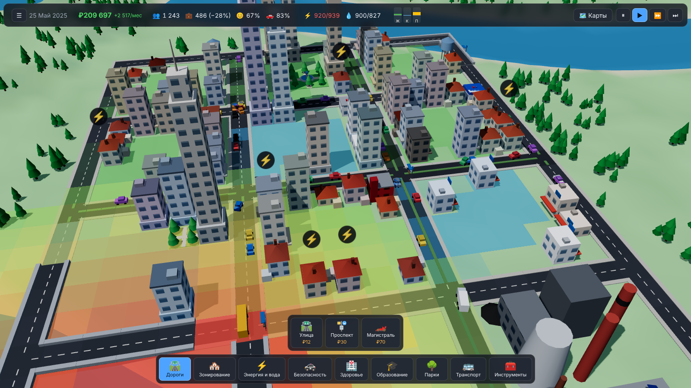

# 🏙️ CitySim 3D

Градостроительный симулятор в браузере в духе Cities: Skylines — 3D-город на **Three.js**, сборка на **Vite + TypeScript + terser**.
Дороги, зонирование, электричество и вода, службы, транспорт (машины, грузовики, автобусы), экономика и бюджет, пожары, смена дня и ночи, сохранения.


<p align="center">
  
  
</p>
<p align="center">
  
  
</p>

## Быстрый старт

Нужен **Node.js 20.19+ / 22+** и браузер с WebGL.

```bash
git clone https://github.com/bandiwor/citysim-3d.git
cd citysim-3d
npm install
npm run dev          # http://localhost:5173
```

Arch Linux: `sudo pacman -S nodejs npm git`.

Продакшн-сборка (с минификацией и манглом `_`-свойств):

```bash
npm run build        # dist/ (+ .gz и .br)
npm run preview      # http://localhost:4173
```

---

## Сжатие JS

См. `vite.config.ts`:

* `build.minify: 'terser'`, 3 прохода compress, `toplevel`, `drop_console`.
* `mangle.properties.regex = /^_/` — **все свойства и методы, начинающиеся с `_`, укорачиваются**.
  Поэтому в коде приватные члены классов пишутся как `private _name` (это правило проекта).
  Публичные поля (`world.road`, `building.pop` …) не трогаются — их безопасно сериализовать/читать снаружи.
* Таргет сборки — `es2022`: поля классов остаются нативными. При более низком таргете их превращают в
  `defineProperty(this, "_x")` со строковыми именами, которые мангл не переименовывает → код ломается.
* Опасные флаги `unsafe_*` не включены: `unsafe_arrows` ломает `new function(){}` внутри three.js.
* Один чанк (`manualChunks: undefined`) — имена после мангла должны быть согласованы по всему бандлу.
* Плагин `precompress` кладёт `*.gz` и `*.br` (для `gzip_static` / `brotli_static`).

## Управление

ЛКМ — инструмент (в режиме «Выбор» перетаскивание двигает камеру) · ПКМ зажать — вращение (клик — отмена инструмента) ·
СКМ / WASD / стрелки — перемещение · Q/E — поворот · R/F — наклон · колесо — масштаб · Пробел — пауза · 1/2/3 — скорость ·
X — снос · B — бюджет · G — статистика · Esc — «Выбор».

## Как устроена игра

* **Дороги** — клеточные (улица / проспект / магистраль), через воду строятся мосты (×3 цена). Здания подключаются к
  улицам и проспектам; магистрали — только для транзита.
* **Сеть** — связная компонента дорог одновременно является сетью электричества и воды: станция снабжает здания,
  связанные с ней дорогами. При дефиците ресурс достаётся старым зданиям.
* **Зоны** R/C/I растут по спросу (столбцы вверху). Спрос считается из рабочих мест, рабочей силы, налогов, счастья, загрязнения.
  Здания растут в уровнях (1–3) при высокой стоимости земли, образовании и счастье; без коммуналки/счастья — забрасываются.
* **Службы** дают покрытие (полиция, пожарные, здоровье, образование, парки), влияющее на счастье и стоимость земли; есть
  источники загрязнения (угольная ТЭС, заводы), шум от трафика. Финансирование служб регулируется в бюджете.
* **Транспорт** — жители ездят домой↔работа/магазины по A*-маршрутам с учётом пробок; грузовики возят товары в магазины;
  автобусные остановки одной сети образуют маршрут, автобусы уменьшают долю поездок на авто и приносят доход.
* **Экономика** — налоги по зонам, содержание дорог/служб/транспорта, кредит, помесячный баланс, история.
* **Пожары** — без пожарной части здание сгорает.
* Автосохранение раз в 3 месяца и при выходе в меню (localStorage), seed карты — на стартовом экране.

## Архитектура и расширение

```
src/
  core/      Game (реестры, системы, шина событий), System/Feature, Tool, Registry, EventBus
  data/      Данные: типы дорог, зон, служб (чистые объекты)
  world/     World (плотные массивы клеток), генерация рельефа, шум
  sim/       Системы симуляции: Network, Utility, Maps, Stats, Demand, Growth, Economy, Traffic, Transit, Disaster, Save
  render/    Three.js: Renderer, виды (Terrain/Road/Building/Vehicle/Tree/…), процедурные модели, камера, день/ночь
  tools/     Инструменты игрока (дорога, зона, здание, снос, остановка)
  ui/        HUD, панель инструментов, модальные окна, ввод
  features/  «Фичи» — пакеты (данные + системы + кнопки + оверлеи), подключаются в main.ts
```

Всё подключается через `Feature`:

```ts
game.use(roadsFeature).use(zonesFeature).use(servicesFeature).use(trafficFeature).use(coreFeature).use(disastersFeature);
```

### Пример: новая служба (свалка)

1. Данные — запись в `src/data/services.ts` (или в своей фиче через `g.services.add(...)`):
   `{ id: 'landfill', category: 'power', size: [2,2], cost: 5000, upkeep: 90, coverage: { type: 'garbage', radius: 14, strength: 1 }, model: 'landfill', ... }`
2. Модель — `serviceModels.set('landfill', () => new GeomBuilder().box(...).build())` в `render/models.ts`.
3. Всё: кнопка на панели создаётся автоматически; новый тип покрытия (`garbage`) заводится картой в `MapsSystem.coverage('garbage')`,
   его можно использовать в `GrowthSystem.happinessOf` и показать оверлеем.

### Пример: новая механика (система)

```ts
// src/features/garbage.ts
declare module '../core/Game' { interface SystemMap { garbage: GarbageSystem } }

class GarbageSystem implements System {
  readonly id = 'garbage';
  readonly order = 45;
  private _game!: Game;
  init(game: Game) { this._game = game; game.bus.on('time:month', () => { /* ... */ }); }
  update(dt: number, realDt: number) { /* dt = игровое время (0 на паузе), realDt — реальное */ }
}

export const garbageFeature: Feature = {
  id: 'garbage',
  install(g) {
    g.addSystem(new GarbageSystem());
    g.overlays.add({ id: 'garbage', name: 'Мусор', icon: '🗑️', colorize: (game, i, out) => false });
    g.toolbar.add({ id: 'my-tool', category: 'tools', name: '…', icon: '🗑️', createTool: (game) => new MyTool(game) });
  },
};
// main.ts: game.use(garbageFeature)
```

Связь между механиками — через шину `game.bus` (типизированные события в `core/events.ts`) и типобезопасный доступ
`game.get('economy')`, `game.get('maps')`, … Новые зоны (например, офисы) добавляются записью в `data/zones.ts` и формулой
спроса `game.get('demand').formulas.set('office', () => …)`; новые типы дорог — записью в `data/roads.ts`.

## Ограничения

Дороги — клеточные (не свободные кривые), здания 1×1 клетка для зон. Отдельные граждане не моделируются — жители агрегированы
по зданиям; машины — визуализация потоков с реальным поиском пути и влиянием пробок на скорость.
